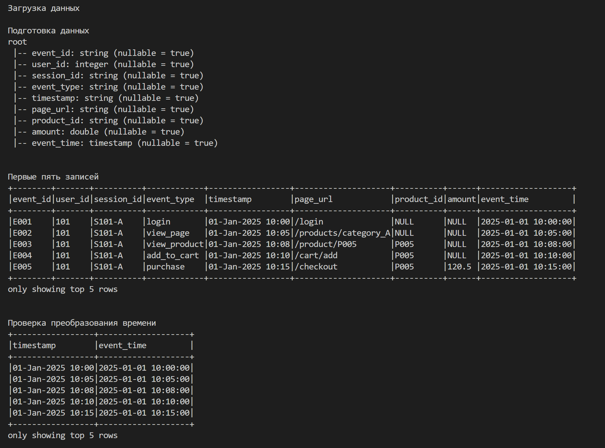
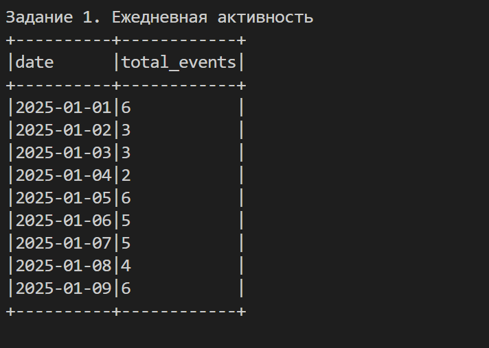
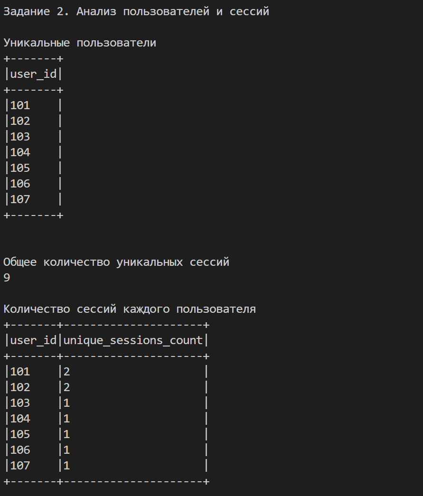
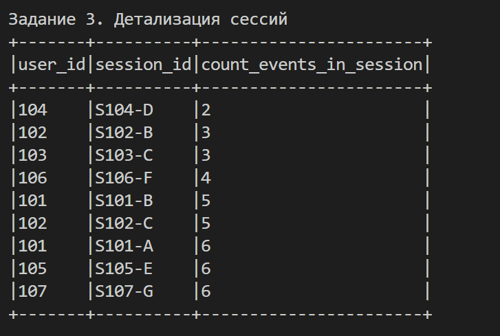
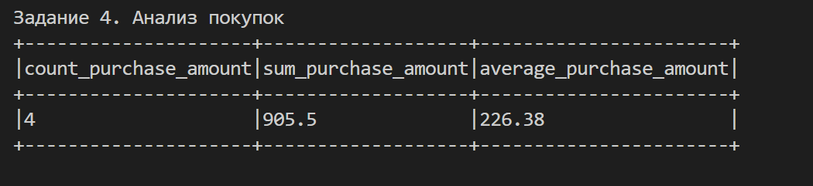
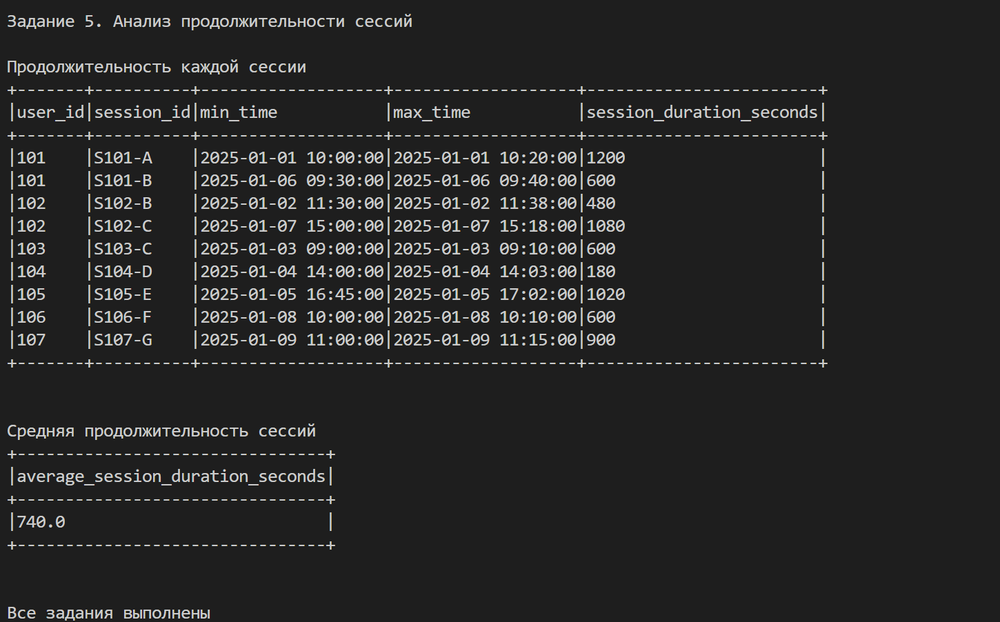

# Лабораторная работа № 3. Выполнила: студент 4-го курса группы ИТБ-О-23/1 Белова Д.А.

**Вариант 3:** Анализ пользовательских сессий


## 1. Используемые средства

- Python 3.11
- PySpark 3.5.9
- Java 17
- Visual Studio Code
- Формат данных AVRO

## 2. Подготовка данных

Исходные данные загружены из файла `activity_log.avro` в DataFrame. Строковый столбец `timestamp` преобразован в `event_time` типа `TimestampType` с помощью `to_timestamp()`.



## 3. Выполнение заданий

### Задание 1. Ежедневная активность

Данные сгруппированы по дате с помощью `groupBy()`. Функцией `count()` подсчитано количество событий за каждый день. Результаты отсортированы по возрастанию даты.

**Результат:** 40 событий за 9 дней.



### Задание 2. Анализ пользователей и сессий

С помощью `distinct()` получены уникальные пользователи и сессии. Функцией `countDistinct()` подсчитано количество сессий каждого пользователя.

**Результат:** 7 пользователей и 9 уникальных сессий.



### Задание 3. Детализация сессий

События сгруппированы по `user_id` и `session_id`. Функцией `count()` определено количество событий в каждой сессии. Результаты отсортированы по возрастанию количества событий.

**Результат:** от 2 до 6 событий в сессии.



### Задание 4. Анализ покупок

С помощью `filter()` отобраны события типа `purchase`. Функциями `count()`, `sum()` и `avg()` рассчитаны количество покупок, общая и средняя сумма.

**Результат:**
- Количество покупок: 4.
- Общая сумма: 905,50.
- Средняя сумма: 226,38.



### Задание 5. Анализ продолжительности сессий

Функциями `min()` и `max()` определено время первого и последнего события каждой сессии. Разница между ними рассчитана в секундах с помощью `unix_timestamp()`. Функцией `avg()` получена средняя продолжительность сессий.

**Результат:** средняя продолжительность сессии составляет 740 секунд.



## 4. Запуск программы

Для запуска необходимы Python 3.11, Java 17 и настроенное окружение Hadoop для Windows.

Установка зависимостей:

```bash
python -m pip install -r requirements.txt
```

Запуск:

```bash
python main.py
```

## 5. Вывод

С помощью PySpark обработаны данные о пользовательских событиях. Определены ежедневная активность, количество пользователей и сессий, показатели покупок и продолжительность сессий. Все пять заданий выполнены, результаты представлены в таблицах.